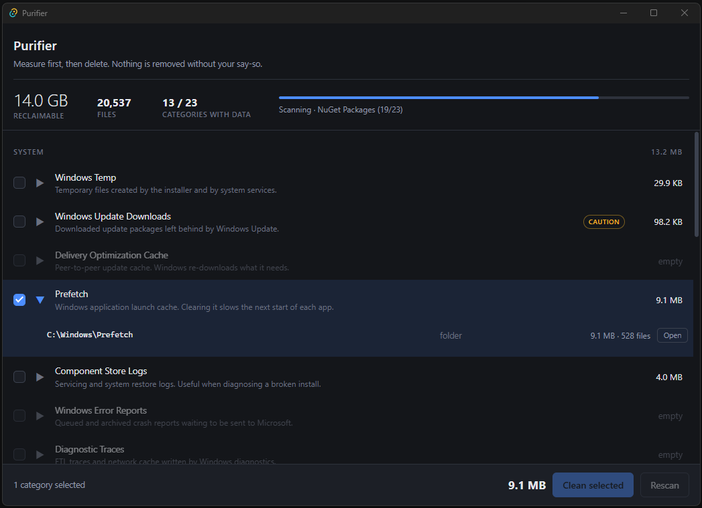

 <div align="center">
  

  <h1>Purifier</h1>

  <p>
    <strong>A lightweight, open-source cleanup utility for Windows.</strong>
  </p>

  <p>
    Clean up temporary files, caches, and application leftovers with a lightweight desktop app built with Rust and Tauri.
  </p>

  <p>
    
    
    
    
    
  </p>

  <p>
    
    
    
  </p>

  <p>
    <a href="https://github.com/GIFUS/purifier-app">Repository</a>
    ·
    <a href="https://github.com/GIFUS/purifier-app/releases">Download</a>
    ·
    <a href="https://github.com/GIFUS/purifier-app/issues">Report a bug</a>
  </p>

  <!-- -->
</div>

## Features

Purifier is a lightweight Windows cleanup utility designed around one principle: **a cleanup tool should never delete files outside its intended scope.** Safety comes first, followed by a clear interface and a straightforward cleanup workflow.

**Safety**

- **Allowlist-only cleanup.** `SecurityGuard` confines every deletion to paths
  declared in the built-in catalog. A path that is not in the catalog is
  rejected before any filesystem call is made.
- **Protected system paths.** A deny-list prevents cleanup of critical Windows directories and
  protected system locations.
- **Junctions are never followed.** Reparse points are detected and skipped to prevent access
  outside the intended cleanup scope.
- **No silent failures.** Read-only attributes are cleared, locked files are retried with backoff,and the final report shows the number of blocked files.

**Interface**

- **Modern UI.** A clean, modern interface with comfortable navigation.
- **Selective cleaning** with a confirmation dialog.
- **Live progress:** phase, completion count and a running message.
- **Final report:** bytes freed, files removed, blocked count.
- **Explorer integration:** open any target in Explorer without leaving the app.

## Cleanup catalog

23 categories across three groups.

| Group | Count | Covers |
| --- | --- | --- |
| System | 8 | Windows Temp, Windows Update downloads, Delivery Optimization cache, Prefetch, Component Store logs, Windows Error Reports, diagnostic traces, system crash dumps |
| User | 6 | User Temp, thumbnail cache, graphics shader cache, Internet cache, application crash dumps, Explorer cache |
| Applications | 9 | npm, Yarn, pnpm, pip, NuGet, Gradle and Cargo caches, Chocolatey temp, Discord cache |

## Technical details

| Component | Technology Stack & Description |
| --- | --- |
| Backend | Rust 2021, Tauri 2, `rayon` for parallel traversal, `walkdir`, `glob`, and `thiserror` |
| Frontend | Svelte 5, TypeScript 6, Vite 8, and `@tauri-apps/api` 2 |
| Styling | Tailwind CSS 4 with the official Vite integration |
| Icons | Lucide icons via `@lucide/svelte` |
| Build tooling | Vite, `@sveltejs/vite-plugin-svelte`, and `svelte-check` |
| Tests | Rust unit tests covering core functionality |
| Permissions | Administrator privileges via an embedded Windows manifest |

### Architecture

Purifier uses **Tauri 2 with a Rust backend and a Svelte 5 frontend**.

The Rust backend handles filesystem operations, cleanup safety, directory traversal, and native Windows integration. The frontend uses Svelte components to manage UI state and render the application interface, Tailwind CSS for styling, and Lucide for consistent icons.

The frontend communicates with Rust through Tauri's command interface and event system:

- `list_categories` — retrieve available cleanup categories.
- `list_groups` — retrieve cleanup category groups.
- `scan_categories` — scan selected categories for cleanup candidates.
- `clean_categories` — clean selected categories.
- `open_in_explorer` — open a target in Windows File Explorer.
- `open_repository` — open the project's repository in the default browser.
- `app_info` — retrieve the running build's version and identifier.
- `app_ready` — signal that the frontend is ready.
- `list_autorun` — list the Run keys and Startup-folder entries.
- `list_autorun_tasks` — list the sign-in triggered scheduled tasks.
- `set_autorun_enabled` — enable or disable one Run or Startup-folder entry.
- `set_autorun_task_enabled` — enable or disable one scheduled task.

This separation keeps filesystem operations in Rust while allowing the UI to evolve independently.

Long-running operations report progress through events:

- `scan://target` — one event per measured target, delivered as each category
  finishes being probed, so rows appear category by category rather than only
  once the whole scan returns.
- `scan://status` — phase, counter and message updates that drive the progress
  bar while scanning and cleaning, plus a final update with the closing summary
  line. The silent re-measure that follows a cleanup emits no status, so it
  cannot overwrite the report still on screen.

### Environment variables

| Variable | Effect |
| --- | --- |
| `PURIFIER_DRY_RUN` / `P_URI_DRY_RUN` | Enable rehearsal mode without performing actual cleanup. |
| `PURIFIER_KEEP_ROOT` / `P_URI_KEEP_ROOT` | Preserve target directories instead of clearing them. |

## Development

**Prerequisites**

- Windows 10 or Windows 11
- Node.js 22.x or newer — Vite 8 requires `^20.19.0 || >=22.12.0`
- Rust stable, with `rustfmt` and `clippy` components
- WebView2, preinstalled on Windows 10 and 11
- An account that can run elevated processes

**Setup and run**

```bash
npm install
npm run tauri dev
```

The Vite dev server listens on `http://localhost:1420` and Tauri attaches to it,
so the frontend reloads on save while the Rust side stays compiled.

**Other commands**

```bash
npm run build           # frontend only: svelte-check && vite build
npm run tauri build     # production bundle
cd src-tauri && cargo test --lib
```

**Before any cargo command**

`generate_context!()` embeds `frontendDist` at compile time and refuses to build
when that directory is missing, so `dist/` has to exist before `cargo check`,
`cargo clippy`, `cargo test` or `cargo build`. The frontend build creates it; if
you only need the Rust side, a placeholder is enough:

```powershell
New-Item -ItemType Directory -Force dist
Set-Content dist/index.html '<!doctype html>'
```

**Rehearsal mode**

To explore the app without deleting anything, set the flag before launching it:

```powershell
$env:PURIFIER_DRY_RUN = "1"
npm run tauri dev
```
